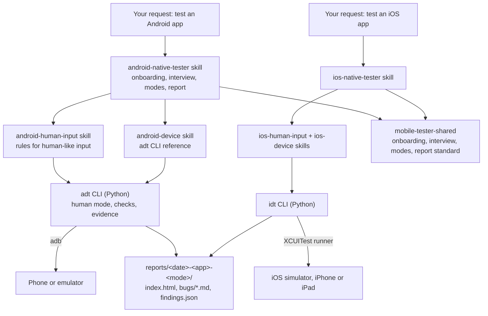

# Mobile Tester

**Let your AI agent test your Android or iOS app the way a person would, on a real phone, an emulator, an iOS simulator or a real iPhone, and hand you a QA report you can act on.**

Mobile Tester is a set of agent skills plus two command-line tools.
It works with any agent that supports [Agent Skills](https://agentskills.io): Claude Code, Codex, OpenCode, pi and others.
It runs exploratory testing, written test cases, bug reproduction and UI/accessibility reviews on any Android or iOS app.
It drives the device with human-like input, checks every step, records evidence, and ends each session with the same standard report and Jira-ready bug drafts.

Ask your agent in plain words:

```
Explore the Notes app on my Pixel for 15 minutes.
```
```
Reproduce PROJ-123 on the iPhone simulator.
```

In Claude Code the same sessions also start with `/android-native-tester` and `/ios-native-tester`.

iOS support is new: it works on simulators, and has no performance or memory measurements yet.
Support for real iPhones and iPads is newer still: so far it has run on one iPhone, over USB and Wi-Fi.

## Why this exists

AI agents can already drive a phone over `adb`.
The trouble is *how* they drive it:

- **Raw adb input is not human input.**
  `adb shell input tap` is a zero-millisecond touch on an exact pixel.
  `input text` pastes a whole string past the keyboard.
  `KEYCODE_BACK` is not the back swipe that gesture-navigation users make.
  Apps, especially WebView and React Native apps, can react differently to each of these.
- **So automation finds bugs that people can't reproduce, and misses ones they hit.**
  While building this project, one "bug" reproduced in 17 of 18 automated runs and in 0 of 2 attempts by a person on the same phone.
  An agent left to itself would have filed it as a confirmed Major bug.
- **Agents act faster than any person, and blindly.**
  A tap swallowed by an overlay, or sent to coordinates from a stale screen, goes unnoticed, and every later step is invalid.
- **Without knowing the app, an agent tests generic things.**
  It checks what apps of some other kind usually do, not what *this* app is supposed to do.
- **Reports come out different every time,** with missing environment details, steps that can't be followed, and no evidence.

Mobile Tester addresses each of these, with rules the model follows and command-line tools that enforce them.

## Main benefits

- **Human-like input by default.**
  60-150 ms presses at a random point near the center of an element (never on a covering control), a short think pause before each action, back and home gestures that match the device's navigation mode, and typing through the real on-screen keyboard.
- **Every action is checked.**
  After each step the CLI waits for the screen to settle and warns when nothing visibly changed, so a swallowed tap is caught at once.
- **Honest bug status.**
  A bug reproduced only by automation is reported as *Unconfirmed*, with automated and manual reproduction counts kept apart.
  The skill offers a recorded manual-reproduction run and compares it frame by frame with the automated one.
- **App-independent, but app-aware.**
  The skills carry no assumptions about any kind of app.
  Onboarding asks you to describe your app (purpose, users, main flows, rules, roles, glossary), and every session judges behaviour against that description and the ticket.
- **A standard QA report every time.**
  Severity and priority, status, environment (device, Android version, navigation mode, keyboard, locale, build and its source), preconditions, steps, expected and actual results, N-of-M reproducibility, screenshots and a video clip per bug.
  The data is validated before the HTML report is built.
- **Evidence without busywork.**
  Screen recording with exact timestamps, a timed log of every action, logcat with crash and ANR extraction, and one-command clip cutting per bug.
- **Safe on your personal phone.**
  Payments, outgoing messages, account changes, accepting terms, and system-setting changes stop and ask, whatever the configuration says.
  Builds from outside a store are checked (signers, splits, permissions) before installing.
- **Autopilot when you want it.**
  Approve defaults for routine decisions once (permission prompts, consent banners, login, crash handling) and the session runs without stopping, logging every decision it made for you.
  Autopilot only covers the skill's own questions; your agent's permission settings (such as Claude Code's auto mode) still decide which files and commands it may use.
- **Jira-friendly.**
  Link a ticket (read through your agent's Jira integration if it has one, or paste it), and get one Markdown bug draft per finding.
  Nothing is created in Jira without your explicit approval.

## How it works



Both CLIs share one core: the report, the finding lifecycle, sessions, guardrails and the screen model.

| Skill | Starts | Purpose |
|---|---|---|
| `android-native-tester` | When you ask to test an Android app ("explore the Notes app for 15 minutes"); in Claude Code also `/android-native-tester` | Onboarding on first use, the session interview, a session in one of six modes, the standard report |
| `android-human-input` | Automatically, whenever a device is driven | The rules for human-like input and honest reproduction |
| `android-device` | Automatically | Reference for the `adt` command-line tool that does the device work |
| `ios-native-tester` | When you ask to test an iOS app; in Claude Code also `/ios-native-tester` | The same session flow on an iOS simulator or a real iPhone or iPad (five modes; memory is Android only for now) |
| `ios-human-input` | Automatically, whenever a simulator or device is driven | Human-like input on iOS: held touches, the left-edge back swipe, typing key by key |
| `ios-device` | Automatically | Reference for the `idt` command-line tool |
| `mobile-tester-shared` | Never on its own | Onboarding, interview, modes, autopilot, report standard and templates used by both testers |

## Requirements

- An agent that supports [Agent Skills](https://agentskills.io): Claude Code, Codex, OpenCode, pi and others (see "Install in any agent").
- For iOS: a Mac with Xcode (simulators come with it), plus uv and ffmpeg as below. The Android tools are not needed for iOS, and the other way round.
- Android SDK Platform-Tools (`adb`).
- [uv](https://docs.astral.sh/uv/), which runs the bundled Python tool with its dependencies; no manual Python setup.
- `ffmpeg` and `ffprobe` for joining recordings and cutting bug clips.
- Optional: a JDK (for `keytool`) or `openssl`, to show certificate owners when inspecting APKs.
- Optional: [scrcpy](https://github.com/Genymobile/scrcpy), to watch the phone on your computer while the agent drives it.

### Windows

```bash
winget install --id Google.PlatformTools -e
```
```bash
winget install --id astral-sh.uv -e
```
```bash
winget install --id Gyan.FFmpeg -e
```
```bash
winget install --id EclipseAdoptium.Temurin.21.JDK -e
```
```bash
winget install --id Genymobile.scrcpy -e
```

If you install Android Studio instead of Platform-Tools, `adt` finds `adb` in the default SDK folder, or wherever `ANDROID_HOME` points.

### macOS

```bash
brew install --cask android-platform-tools
```
```bash
brew install uv ffmpeg scrcpy
```
```bash
brew install --cask temurin
```

### Linux (Debian, Ubuntu, Kubuntu)

```bash
sudo apt install adb ffmpeg openjdk-21-jre-headless scrcpy
```
```bash
curl -LsSf https://astral.sh/uv/install.sh | sh
```

## Prepare an Android phone

1. Open **Settings > About phone** and tap **Build number** seven times to enable Developer options.
2. In **Settings > System > Developer options**, turn on **USB debugging**.
3. Connect the phone with a USB cable and accept the **Allow USB debugging?** prompt (tick "Always allow from this computer").
4. Check the connection:
   ```bash
   adb devices
   ```
   The phone should be listed as `device`, not `unauthorized`.

Some brands need their own USB driver on Windows (for example Samsung's; Pixel phones use the Google USB Driver from Android Studio's SDK Manager).
An emulator from Android Studio works too and is the better choice for tests that change system settings (font size, dark mode, rotation).

## Prepare an iOS simulator

1. Install Xcode from the App Store, open it once to finish setup, then check the command line tools:
   ```bash
   xcode-select -p
   ```
2. Boot a simulator (names: `xcrun simctl list devices`) and open the Simulator app to watch it:
   ```bash
   xcrun simctl boot "iPhone 17"
   ```
   ```bash
   open -a Simulator
   ```
3. The app under test must be a simulator build (`.app`, built with `xcodebuild -sdk iphonesimulator`); App Store apps and `.ipa` files don't run on simulators. Built-in apps such as Reminders and Contacts are always there.
4. If the on-screen keyboard doesn't show when a text field is tapped, turn it on in Simulator: I/O > Keyboard > Toggle Software Keyboard (cmd-K). The tester types on it key by key.

The first `idt` command that touches the screen builds the XCUITest runner (about a minute, once per Xcode version) and starts it (about 15 seconds per simulator boot).

## Prepare a real iPhone or iPad

This support is new and has run on one iPhone (USB and Wi-Fi) so far; expect rough edges and tell us what you hit.
A real device runs the same XCUITest runner, signed with your Apple development team.
Every step here is yours: the tester tells you what is missing (`idt doctor` prints a `to do:` line per device) and waits.

1. Connect the device by cable, unlock it and tap **Trust**.
   After that it also works over Wi-Fi, but you name it with `-s` there, and USB is faster.
2. On the device, turn on **Settings > Privacy & Security > Developer Mode** and restart it.
   Then turn on **Settings > Developer > Enable UI Automation**.
3. Sign in to Xcode with your Apple ID: **Xcode > Settings > Accounts**.
   A free personal team works; the first time, the device asks you to trust the developer under **Settings > General > VPN & Device Management**.
   Its signing lasts 7 days; the tester renews it by itself when less than a day is left.
4. Give the tester your team id (10 letters and digits, shown in Xcode's Accounts pane or on developer.apple.com under Membership); it runs:
   ```bash
   idt -s <device UDID> runner build --team <TEAMID>
   ```
   Xcode creates a development certificate and profile in that team and registers the device with it.
   The team is remembered on this Mac.
5. Keep the device unlocked while it is tested.

idt reaches the runner through the encrypted tunnel Xcode's CoreDevice keeps to the device; the runner accepts no connections from the network, and each request carries a token only idt knows.
A real device counts as personal unless your device inventory says otherwise: installing, uninstalling and clearing an app's data there are refused until you approve them, and the report says the device is physical and personal.
The app under test is whatever is installed on the device (App Store apps too), or a signed device build (`.app`, or the `.app` inside an `.ipa`).

## Install in any agent

The skills follow the open [Agent Skills](https://agentskills.io) format, so any agent that reads `SKILL.md` folders can use them: Codex, OpenCode, pi, Claude Code and others.
Two parts: the `adt` and `idt` commands the skills call, and the skill folders.

1. Install `adt` and `idt` as commands (needs [uv](https://docs.astral.sh/uv/)):

   ```bash
   uv tool install git+https://github.com/ilivinskyi/mobile-tester
   ```

   Check it with `adt doctor` (Android) or `idt doctor` (iOS).

2. Get the skills:

   ```bash
   git clone https://github.com/ilivinskyi/mobile-tester.git ~/mobile-tester
   ```

3. Copy the folders in `skills/` into a skills folder your agent reads.
   For all your projects (global), `~/.agents/skills/` is read by Codex, OpenCode and pi:

   ```bash
   mkdir -p ~/.agents/skills && cp -R ~/mobile-tester/skills/. ~/.agents/skills/
   ```

   On Windows (PowerShell):

   ```powershell
   New-Item -ItemType Directory -Force "$HOME\.agents\skills"; Copy-Item -Recurse -Force "$HOME\mobile-tester\skills\*" "$HOME\.agents\skills\"
   ```

4. Start a new agent session and ask it to test an app, for example "explore the Notes app on my phone for 15 minutes".

| Agent | Global (all projects) | One project only |
|---|---|---|
| Codex | `~/.agents/skills/` | `.agents/skills/` |
| OpenCode | `~/.agents/skills/` or `~/.config/opencode/skills/` | `.agents/skills/` or `.opencode/skills/` |
| pi | `~/.agents/skills/` or `~/.pi/agent/skills/` | `.agents/skills/` (after you trust the project) or `.pi/skills/` |
| Claude Code | `~/.claude/skills/`, or the plugin below | `.claude/skills/` |
| Other Agent Skills agents | their skills folder | their project skills folder |

These folders change between agent versions; check your agent's skills documentation if the skills don't show up.

To update later:

```bash
uv tool upgrade mobile-tester
```
```bash
git -C ~/mobile-tester pull
```

Then copy the skill folders again (or link them instead of copying, so `git pull` is enough).

Installed it before the project was renamed from android-tester?
Remove the old command first (`uv tool uninstall android-tester`), then install as above; the old Android-only skill folders can be replaced by the new ones.

## Install as a Claude Code plugin

In Claude Code the plugin is an alternative to the steps above: it brings the skills and runs `adt` and `idt` from its own copy, so nothing else needs installing.

```
/plugin marketplace add ilivinskyi/mobile-tester
```
```
/plugin install mobile-tester@mobile-tester
```

On Claude Code 2.1.275 or later, one step does both:

```
/plugin install mobile-tester --marketplace ilivinskyi/mobile-tester
```

Or from a terminal:

```bash
claude plugin marketplace add ilivinskyi/mobile-tester
```
```bash
claude plugin install mobile-tester@mobile-tester
```

Start a new session afterwards.
Typing `/` should now list `android-native-tester` and `ios-native-tester`.

To try it without installing, clone the repo and load it for one session:

```bash
git clone https://github.com/ilivinskyi/mobile-tester.git
```
```bash
claude --plugin-dir ./mobile-tester
```

## Run your first session

Open your agent in a folder where reports and settings should live (for example a QA folder or your app's repository), and ask it to test your app:

```
Test the Notes app on my phone for 15 minutes.
```

For an iOS app, say so ("on the iPhone simulator", "on my iPhone"); everything below works the same, with a simulator or iPhone in place of the Android phone.
In Claude Code, `/android-native-tester` and `/ios-native-tester` start the same skills.

1. **Onboarding (first time only).**
   Your name for reports, the reports folder, an optional Jira project, your devices (and which one is personal), an app profile with a description of your app in your own words, whether to report problems noticed outside a session's scope (and which unfinished areas to never report), and whether to use autopilot.
   Everything is saved in `.mobile-tester/` so later sessions start straight away; one setup serves both platforms.
2. **Session interview.**
   Which app (type its name as on your phone, or its package id; the agent finds it on the device and lets you pick when several match) or build file, a ticket or context, the mode, the charter, the device, the time box, and what evidence to collect.
   The skill sums it up as a plan and waits for your go.
3. **Preparation.**
   Device check, build check and install when needed, your setup hooks, a reset to the start state, then screen recording and log capture start.
4. **Testing** in the chosen mode, writing findings as it goes.
5. **Wrap-up.**
   A video clip per bug, the report checked and built, an offer to reproduce unconfirmed bugs by hand, Jira drafts, and new knowledge about the app added to its notes.

### Modes

| Mode | Ask for example | What happens |
|---|---|---|
| `explore` | "Explore com.example.app for 30 minutes" | Time-boxed exploratory testing guided by a charter, the app's main flows and rules |
| `test-case` | "Run the test cases in tests/TC-001.md" | Runs written test cases step by step and reports pass, fail or blocked per step |
| `repro` | "Reproduce PROJ-123" | Reproduces a reported bug, narrows the trigger one variable at a time, confirms with a person |
| `ui-review` | "Review the UI and accessibility of the checkout screens" | Accessibility (touch targets, labels, contrast, screen-reader text) and visual review |
| `retest` | "Check what's fixed in build 2.4" | Runs the regression test cases of the app's open known issues on a new build and marks each Fixed, Still reproduces or Can't verify |
| `memory` | "Check the product screens for memory leaks" | Repeats flows and watches live Activities, Views and memory per cycle to find leaks (Android only for now) |

On Android, the app's own log is checked after each action (errors, caught exceptions, network failures, out of memory), and memory is sampled every 10 actions; both end up in the report.

The tools also cover what manual QA always checks:
- **Process death:** `adt app kill-background` kills the app in the background the way Android does under memory pressure, returns to it and compares the screen.
- **Permissions:** apps install without pre-granted permissions, so their prompts appear; `permissions grant|revoke|reset` changes them mid-session.
- **Links:** `app links` lists the deep links and Universal Links an app declares, `open` opens them from a cold or warm start.
- **Config and network:** `env` (dark mode, font or text size, orientation, RTL) and `adt net offline|online`; every changed setting is restored at `session end`.
- **OS handoffs:** notifications, gallery media, clipboard, location and Face ID / Touch ID / fingerprint, where the platform allows it (some only on emulators and simulators).
- **Build comparison:** `report diff RUN_A RUN_B` compares two runs: performance, new findings, issues gone, new log errors, screens reached.
- **Technical data:** `report telemetry RUN` records how a run was produced: agent tokens and cost at API list prices (from the Claude Code transcript), time per phase, tool calls, device actions and evidence size.
  It is shown at the end of the report, and every run adds a row to `<reports dir>/telemetry.csv`, so the skill's cost and speed can be tracked over time.
On iOS, the app's unified log is recorded with the session and every action checks for a new crash report.

### After the session

- **Confirm findings by hand.** Tell the agent "B3 reproduced 2 of 2 on my phone" (or run `adt report confirm` / `idt report confirm`): the finding gets a history entry, its manual count and status update, and the report is rebuilt.
- **Known issues.** Every bug lands in the app's known-issues registry with a regression test case draft. Later sessions link a known bug found again ("K-3 seen again") instead of reporting it as new, and reopen fixed issues that come back.
- **Crashes and performance.** A crash is caught at the action that caused it. On Android each session also records cold start time, janky frames and memory, so a slower build shows up in the report.

In Claude Code, if the short name clashes with another command, use the namespaced form `/mobile-tester:android-native-tester` or `/mobile-tester:ios-native-tester`.

## What a session produces

```
reports/2026-10-23-myapp-explore/
  index.html        the finding list: summary, findings grouped by severity, search, filters
  bugs/B1.html      one page per finding: Jira copy buttons, steps, expected and actual, evidence viewer
  bugs/B1.md        Jira-ready bug drafts, one per bug and accessibility finding
  findings.csv      every bug and accessibility finding, for Jira's CSV import
  findings.json     machine-readable findings
  session.json      device, app, ticket, charter, timing, environment
  screenshots/      evidence, with the UI tree (Android XML, iOS JSON) next to each screenshot
  videos/           session.mp4 plus one clip per bug
  logs/             actions.jsonl (every action, timed), logcat.txt (Android) or app.log (iOS), decisions.md
```

Each finding has an id, title, type (bug, accessibility, observation), severity (Blocker to Trivial), suggested priority (P1-P4), status (Confirmed, Unconfirmed, Retracted), preconditions, steps, expected and actual results, reproducibility (automated and manual N of M) and evidence.
The report is the same on both platforms; only the device facts in it differ (for example "Pixel 7a, Android 15 (API 35)" or "iPhone 17, iOS 27.0, simulator").
`adt report check` / `idt report check` rejects incomplete or misleading data, for example a Major bug marked Confirmed when only automation reproduced it.

## Project configuration

Onboarding writes this into the folder you test from:

```
.mobile-tester/
  config.yaml                 tester, reports, Jira, device inventory, autopilot
  state/                      per-device state of adt and idt (not for git)
  apps/<package or bundle id>/
    profile.yaml              what the app is and how it works (about), store URL, expected signer,
                              login method, reset strategy, hooks, risky areas, platform
    notes.md                  what testers learn over time: screen map, quirks, known issues
    hooks/  checks/           your setup, reset, teardown and login scripts and custom checks
    known-issues.json         bugs found across sessions, their status and where they were seen
    tests/                    regression test cases, one per known issue (drafted automatically)
    secrets.local.yaml        test credentials, filled in by you (keep it out of git)
```

Add `.mobile-tester/state/` and `.mobile-tester/**/secrets.local.yaml` to your `.gitignore`; onboarding offers to do it.

## Human-like input in detail

| A person | Raw adb | Mobile Tester (`adt`, default) |
|---|---|---|
| Presses for about 100 ms | `input tap`: 0 ms | 60-150 ms press (`input swipe` held in place) |
| Hits near the middle, never the same pixel twice | The exact center | Random point near the center, avoiding anything that covers the element |
| Looks, then acts | Instant, back to back | 0.4-1.4 s think pause, then waits until the screen stops changing |
| Notices when nothing happened | Never | Compares the screen before and after, warns on "no visible change" |
| Swipes back from the edge (gesture navigation) | `KEYCODE_BACK` | Edge swipe in gesture mode, the navigation-bar key in 3-button mode |
| Types on the keyboard, with autocorrect | `input text` pastes past the keyboard | Taps the keyboard's own keys, including shift and symbol layers |

On iOS, `idt` does the same through its XCUITest runner: held touches at a random uncovered point, the same pacing and change check, back as the left-edge swipe (iOS has no system back key), and typing key by key on the on-screen keyboard, including shift and the number and symbol layers.

`--fast` switches back to instant input for setup steps only (installing, resetting data, getting to the start state), and every fast step is marked in the report.

Every run that is compared with another starts from the same state: the session itself, each reproduction attempt, each test case and each retested known issue.
`adt app reset` restarts the app, or clears its data first so it is like a fresh install; which one is set per app in its profile (or an app-specific reset script), and clearing data on a personal phone is always asked first.

## Guardrails

These always stop the session and ask, even in autopilot:

- Purchases, payments, subscriptions.
- Sending messages, posts, reviews, invites or feedback.
- Account deletion, logout, password or email changes.
- Accepting terms, consent, or OAuth/SSO permissions.
- System-setting changes and clearing app data on a device marked personal.
- Installing a build that fails the signer and package checks.
- Creating or changing Jira issues.

The CLI also refuses to tap elements labelled like payment, messaging or account-destroying actions until you approve that one action.

## The `adt` and `idt` command-line tools

The skills drive everything through `adt` (Android) and `idt` (iOS), two small Python tools in `scripts/` with the same command names where the platforms allow.
Installed as a command (see "Install in any agent"):

```bash
adt doctor
```

The Claude Code plugin, and a clone of this repo, run it through uv without installing:

```bash
uv run --script scripts/adt.py doctor
```

It covers device facts, observing the screen (hierarchy plus annotated screenshot), human-like actions, app management, APK inspection, sessions, recording, clips, logcat, hooks and reports.
See [skills/android-device/reference.md](skills/android-device/reference.md) for every command.

`idt` works the same way:

```bash
uv run --script scripts/idt.py doctor
```

It covers simulators and real devices, the XCUITest runner, observing (element tree plus annotated screenshot), human-like actions, app install and reset, sessions, recording, clips, the app log, crash reports, hooks and reports.
See [skills/ios-device/reference.md](skills/ios-device/reference.md) for every command.

## Limitations

- On-screen typing is tuned for Gboard with English key names; other keyboards and languages fall back to per-character key events (or ask).
- Apps are launched through their launcher intent, not by tapping the icon.
- Screens protected with FLAG_SECURE (banking apps, DRM video) record and screenshot as black.
- A UI that never goes idle (endless animation, video) can make the hierarchy dump fail; the tool falls back to screenshots.
- Inputs injected over adb come from a virtual input device, so a bug that only automation reproduces stays Unconfirmed until a person reproduces it. That's deliberate.
- iOS: no performance, memory or leak checks yet; each key press takes about half a second because XCUITest waits for the app to go idle; accented letters (long press) and other keyboard languages stop and ask.
- iOS real devices: no app log streaming yet (crash reports work); video only where Xcode offers recording for the device (an iPhone 15 Pro Max doesn't); typing needs Apple's keyboard, not a third-party one; over Wi-Fi every step is slower than over USB.
- iOS: an app only shows in `idt observe` when `idt` knows its bundle id (the session's app, the last launched one, or `--app`).

## Development

```bash
uv run --group dev pytest
```
```bash
uv run --group dev ruff check scripts tests
```
```bash
claude plugin validate .
```

The last one checks the Claude Code plugin manifest in `.claude-plugin/`.

The design decisions are in [docs/spec.md](docs/spec.md).
The tests use UI dumps captured from devices and simulators, plus screens of a made-up app ("Pantry") that recreate situations seen on real devices.
The iOS runner is an Xcode project in `scripts/mobiletester/ios/runner/`; `idt runner build` builds it into `~/Library/Caches/mobile-tester`.

## License

[MIT](LICENSE)
